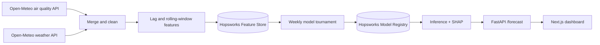

<div align="center">


<p>
  <a href="https://github.com/21Afnan/AirLyst/actions/workflows/feature_pipeline.yml"></a>
  <a href="https://github.com/21Afnan/AirLyst/actions/workflows/training_pipeline.yml"></a>
</p>

<p>
  
  
  
  
  
</p>

**[Live dashboard](https://air-lyst.vercel.app)** · Data Science internship project at 10Pearls Pakistan

</div>

---

## Why AirLyst

Islamabad's air quality can swing from healthy to hazardous within a day, and a weather app that only shows *today's* AQI does not help you plan tomorrow's run, school trip or commute. **AirLyst forecasts the Air Quality Index hour by hour for the next 72 hours**, explains in plain language *why* the air is getting better or worse, and keeps itself up to date with no manual work.

<table>
<tr>
<td align="center" width="33%"><br/><b>Live AQI and 3-day outlook</b></td>
<td align="center" width="33%"><br/><b>Hourly forecast with EPA colour bands</b></td>
<td align="center" width="33%"><br/><b>SHAP drivers in plain English</b></td>
</tr>
</table>

## How it works



| Stage | What happens | Runs |
|---|---|---|
| **Feature pipeline** | Pulls the latest air quality and weather data, merges them, builds lag and rolling features, and writes them to the Hopsworks Feature Store | Daily at 00:00 UTC (GitHub Actions) |
| **Training pipeline** | Splits the data chronologically (no future leakage), trains Ridge, Random Forest, XGBoost and LightGBM, ranks them and registers the champion | Weekly, Sunday 02:00 UTC (GitHub Actions) |
| **Inference** | Loads the champion model, forecasts 72 hours ahead and computes SHAP values for each forecast in memory | On request |
| **Explanations** | An LLM (Gemini through OpenRouter) turns the top SHAP drivers into a short, human-readable insight | On request |
| **Dashboard** | AQI dials, weather metrics, hourly trend chart with EPA colour bands, and the AI insight card; falls back to mock data if the API is down | [air-lyst.vercel.app](https://air-lyst.vercel.app) |

Keeping every feature in one feature store means training and serving always see exactly the same inputs, which avoids training-serving skew.

## Model tournament results

| Model | MAE | RMSE | R² | Composite rank |
|---|:---:|:---:|:---:|:---:|
| **LightGBM (champion)** | **1.729** | **3.236** | **0.986** | **1st** |
| XGBoost | 1.890 | 3.464 | 0.984 | 2nd |
| Random Forest | 1.663 | 3.503 | 0.984 | 2nd |
| Ridge Regression | 2.930 | 4.799 | 0.969 | 4th |

The composite score adds each model's rank across MAE, RMSE and R² (lower is better). The tournament reruns every week, so the champion can change as new data arrives.

## Run it

**Backend**

```bash
git clone https://github.com/21Afnan/AirLyst.git
cd AirLyst
python -m venv venv
venv\Scripts\activate            # macOS/Linux: source venv/bin/activate
pip install -r requirements.txt
uvicorn backend.src.api.main:app --reload --port 8000
```

Interactive API docs: `http://localhost:8000/docs`. Settings load from a `.env` file through `backend/src/utils/config.py`; the main ones are `HOPSWORKS_API_KEY`, `HOPSWORKS_PROJECT`, `HOPSWORKS_HOST` and the key for the AI insight model. City and coordinates default to Islamabad (`CITY`, `LATITUDE`, `LONGITUDE`) and can be changed to forecast another city.

**Frontend**

```bash
cd frontend
pnpm install
pnpm dev
```

Open `http://localhost:3000`.

## Repository layout

```
AirLyst/
├── .github/workflows/      # daily feature and weekly training pipelines
├── backend/
│   ├── notebooks/          # 01 acquisition to 06 model tournament
│   ├── data/               # raw, cleaned and engineered datasets
│   ├── reports/            # SHAP explanation report
│   └── src/
│       ├── data_ingestion/ # air quality and weather clients
│       ├── feature_pipeline/
│       ├── ml/             # preprocessing, models, training, inference, SHAP
│       ├── api/            # FastAPI app and forecast route
│       └── utils/
├── frontend/               # Next.js and Tailwind dashboard
├── assets/                 # screenshots and demo video
└── Final_Report.pdf
```

A screen recording of the live system is in [`assets/video/live_working-video.mp4`](assets/video/live_working-video.mp4), and the full write-up is in [`Final_Report.pdf`](Final_Report.pdf).

## Tech stack

| Layer | Technology |
|---|---|
| Data | Open-Meteo APIs, pandas, NumPy |
| Feature store and registry | Hopsworks |
| Models | LightGBM, XGBoost, Random Forest, Ridge (scikit-learn) |
| Explainability | SHAP, Gemini via OpenRouter |
| Serving | FastAPI |
| Frontend | Next.js, Tailwind CSS, Vercel |
| Automation | GitHub Actions (CI/CD) |

---

<div align="center">

Built by **Afnan Shoukat** during the Data Science internship at **10Pearls Pakistan**

<a href="mailto:afnanshoukat35@gmail.com"></a>
<a href="https://www.linkedin.com/in/afnanshoukat"></a>
<a href="https://github.com/21Afnan"></a>

</div>
